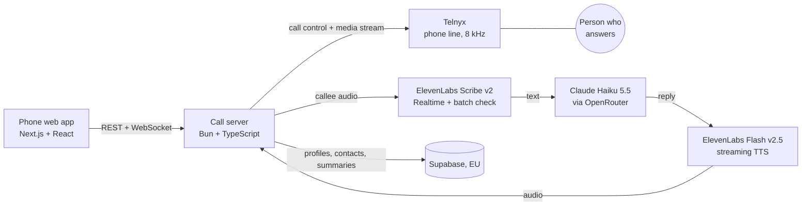

# Spoken

Spoken: type what you need, an AI makes the phone call for you. Oslo Sprint 2026.

## Pitch

See [pitch preparation](PITCH.md) for jury questions, evidence to prepare, and the rehearsal checklist.
**Du skriver, vi snakker. You type, we talk.**

Spoken makes phone calls for you. You type what you need ("order a large pepperoni for pickup at six"), and an AI calls the place, talks to the person who answers in Norwegian, and shows you every word live on screen. It says it's an AI in its first sentence, and it asks you before it agrees to any price, time or booking.

Built for Deaf and nonspeaking people, and useful for anyone who would rather not call.

**Try it:** https://spoken-api.hellosverre.com/ (demo login `demo` / `demo`). Without the owner's passcode, calls run in mock mode against a scripted callee, so nobody is dialled.

Oslo Sprint 2026. This repo was created Sat 7 Nov 09:01, and everything in it was written during the hackathon.

## How a call works

1. **You type the errand.** Presets cover common calls (pizza, doctor, haircut, calling mom), or you write your own.
2. **Spoken checks the details and shows a plan:** who it will call, what it wants, and what it will ask you about first. You tap Start.
3. **It makes the call.** The callee's speech appears as text as they talk. You can send new instructions mid-call ("ask if they have gluten-free").
4. **Nothing is agreed without you.** When the callee offers a price or a time, an approval card pops up with big Yes / No buttons. If you take a while, Spoken asks them to hold and plays hold music.
5. **Afterwards** you get a result card (what was agreed, the price, the time) and the full transcript.

## Safety

- Every call opens with «Hei, jeg er en KI-assistent som ringer på vegne av …». If the callee doesn't want to talk to an AI, it ends the call politely.
- It never commits to paying, booking or cancelling without a tap from you.
- It never calls emergency numbers (110, 112, 113). It shows you the right number to call yourself.
- It refuses abusive goals and is capped at a set number of calls per user per day.
- Your account stores your profile, contacts and call summaries, but not transcripts or audio (`server/db/schema.sql`). The data processors are listed in the app under Profile → Privacy.

## How it's built



The hard part is keeping a phone conversation natural on 8 kHz audio in Norwegian:

- **Turn-taking:** waits for the answerer's greeting before speaking, never gets cut off during the AI disclosure, and stops talking when the callee talks over it (barge-in).
- **Numbers:** Norwegian numbers like *femten* and *femti* (15 and 50) sound alike on a phone line. Unsure numbers are flagged to the LLM, which asks back instead of guessing.
- **A second listen:** every callee line also goes through batch Scribe. If batch is confident and realtime isn't, batch wins. Lines it tags as background talk or music are dropped.
- **Background voices:** the server learns the callee's loudness and ignores quieter voices in the room.

### Built with ElevenLabs

| Product | What it does in Spoken |
|---|---|
| Scribe v2 Realtime | Live speech-to-text of the callee (Norwegian, phone audio), with key terms from the task |
| Scribe v2 (batch) | A second opinion on every line, to get numbers and names right |
| Flash v2.5 TTS | Spoken's voice, streamed into the call as μ-law audio |

## Repo layout

| Path | What |
|---|---|
| `web/` | Phone-first web app (Next.js, React, plain CSS, EN/NO, dark and light) |
| `server/` | Call server: REST, live WebSocket, Telnyx, Scribe, LLM agent, TTS, safety rules, tests |
| `shared/contract.ts` | Types shared by the app and the server |
| `CONTRACT.md` | The API between the app and the server |
| `SPEC.md` | Product decisions |
| `HANDOFF.md` | Current state, deploy steps and next tasks |

## Run it locally

The whole flow runs with no API keys in mock mode, against a scripted Norwegian Domino's call.

Server ([Bun](https://bun.sh)):

```bash
cd server && bun install
CALL_PROVIDER=mock LLM_PROVIDER=mock bun src/index.ts
```

Web app:

```bash
cd web && npm install
NEXT_PUBLIC_SPOKEN_API=http://localhost:8787 npm run dev
```

Without `NEXT_PUBLIC_SPOKEN_API`, the app plays its built-in scripted calls. Press **D** for a hands-free demo, **L** to switch language.

Tests:

```bash
cd server && bun test
```

Real calls need Telnyx, ElevenLabs and OpenRouter keys. See `server/.env.example` and `server/README.md`. Keys live in env only, never in the repo.

## Team

Sverre, Jakob
